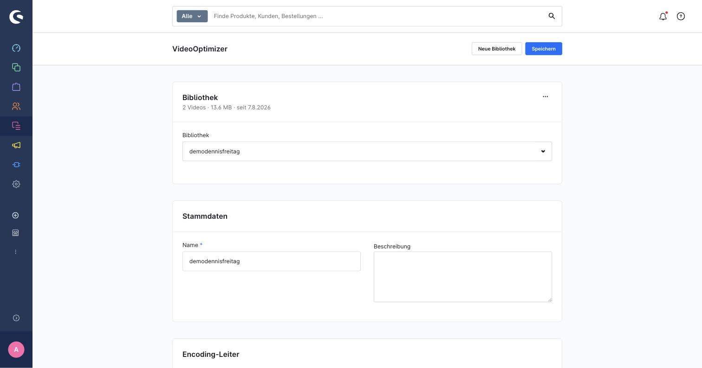
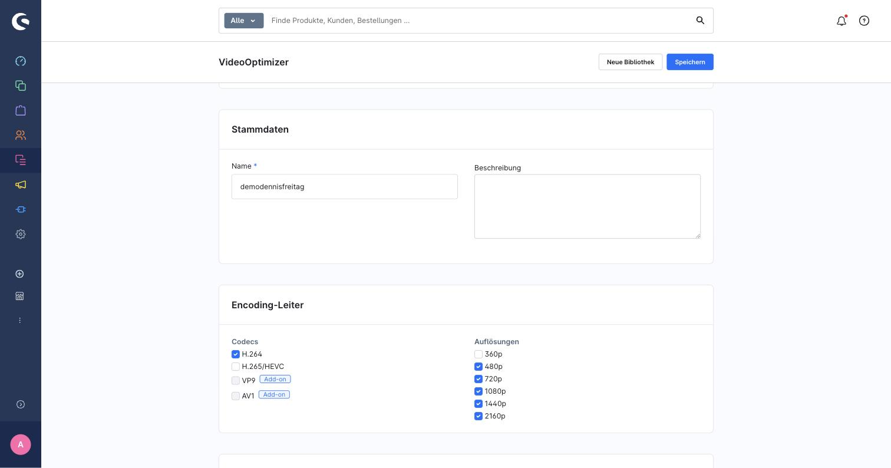
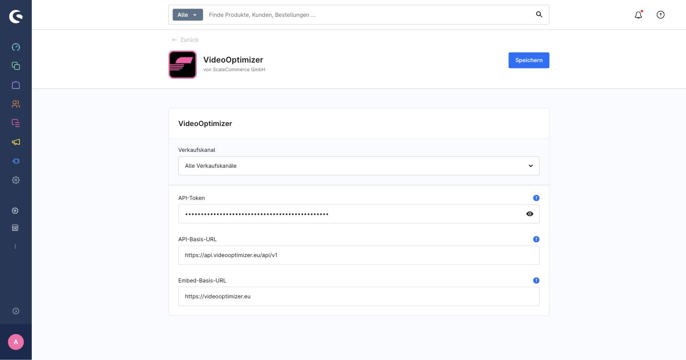
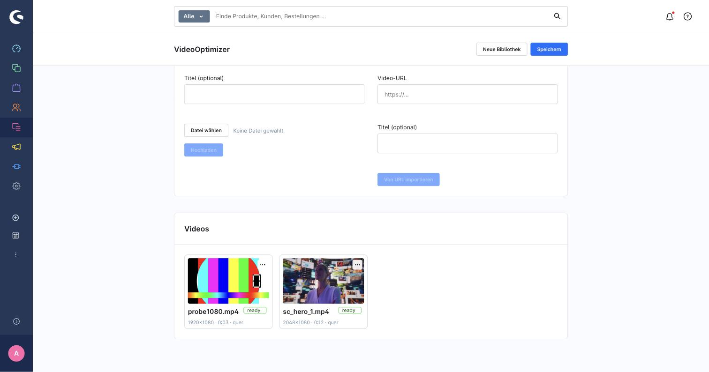
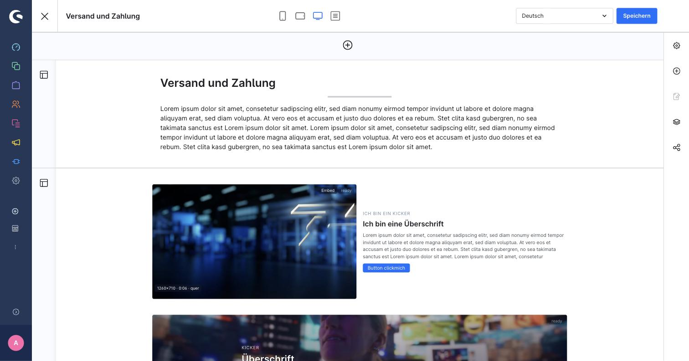

<div align="center">

# 🎬 VideoOptimizer for Shopware

**Deliver fast, adaptive, CDN-hosted video on your Shopware storefront — managed right inside the admin.**

[](https://packagist.org/packages/scalecommerce/videooptimizer-shopware)
[](https://www.php.net/)
[](https://www.shopware.com/)
[](LICENSE)

[Product](https://videooptimizer.eu/) · [API & docs](https://api.videooptimizer.eu/) · [Report a bug](https://github.com/ScaleCommerce/videooptimizer-shopware/issues)

</div>

---

Manage VideoOptimizer libraries and videos without leaving Shopware, then embed them anywhere in **Shopping
Experiences** via five ready-to-use CMS elements/blocks. A privacy-friendly, high-performance alternative to
YouTube, Vimeo and self-hosting — the API token stays server-side, proxied through Shopware.

> Built and maintained by **[ScaleCommerce GmbH](https://scale.sc/)**, the team behind
> [VideoOptimizer](https://videooptimizer.eu/). Part of the `scalecommerce/videooptimizer-<platform>`
> plugin family.

<div align="center">



<sub>The library page follows Shopware's native layout — smart bar, cards, context menus.</sub>

</div>

## ✨ Highlights

- 📚 **Library management** — create and edit libraries (name, description) and their encoding ladder (codecs and resolutions), with add-on/unavailable options shown but disabled per the organization's plan; requeue all of a library's videos for re-encoding with the current ladder ("reprocess").
- ⬆️ **Upload, URL import, rename, delete** — upload via presigned multipart upload (transferred directly to storage, not through Shopware) with progress, cancel and automatic retries, or import a video from a public `https://` URL. Processing is tracked in the background; large libraries load page by page. Deleting a video or a library asks for confirmation first.
- 🖼️ **Video detail overlay** — pick the poster from 10 auto-generated frames, or upload a custom one (from disk or the Shopware media library); shows dimensions, duration and orientation.
- 🧱 **Five CMS elements/blocks** — `Video`, `Media split`, `Background hero`, `Spotlight` and `Video grid`, each with a presentation mode (poster/facade, lightbox, or embedded directly) and a player mode (native adaptive HLS via hls.js, or the hosted VideoOptimizer embed).
- ⚡ **Storefront performance** — the player code and hls.js (light build) load only on pages with a video, and segments only once playback starts; autoplaying videos run only while visible. Embed lookups of a page run concurrently and are cached per video.
- ♿ **Accessible** — titled embeds, keyboard-friendly facade and a lightbox built on a native modal `<dialog>` (focus stays inside, inert background, Escape), a pause button for the background hero and no autoplay with `prefers-reduced-motion`.
- 🗂️ **Cache-aware** — pages are tagged per video, so changes in the administration invalidate exactly the affected storefront pages; a page rendered during an API outage is cached for 60 seconds only.
- 🔐 **Token never touches the browser** — stored server-side in the plugin configuration; all admin and storefront traffic to VideoOptimizer is proxied through Shopware. The administration only offers the actions a user's role allows and explains a missing token or permission.
- 🧩 **Runs on 6.6 and 6.7** — compiled administration (6.6 webpack + 6.7 Vite) and storefront assets are shipped, no build step required.

<details>
<summary><b>Why deliver video through VideoOptimizer's CDN?</b></summary>

Video is the heaviest asset on most shop pages. Where it is hosted decides your page speed, your bandwidth
bill, your conversion rate and your data-protection exposure.

### vs. self-hosting (MP4 in your shop's media manager)
- **Traffic stays off your server.** Every play of a self-hosted video streams gigabytes straight from your
  web/origin server, competing with real shop requests and running up egress cost. VideoOptimizer serves
  every byte from **edge CDN nodes**, so your Shopware instance stays fast even during campaigns and traffic
  spikes.
- **Adaptive bitrate (HLS) instead of one big file.** VideoOptimizer automatically transcodes each upload
  into multiple resolutions (up to 4K) and streams **HLS**: the player picks the optimal quality for each
  visitor's device and connection — instant start, no buffering, no wasted mobile data.
- **No manual encoding.** Upload once; VideoOptimizer handles transcoding, posters and thumbnails.
- **Better Core Web Vitals.** Offloading heavy video improves LCP and overall storefront performance.

### vs. YouTube / Vimeo embeds
- **Your brand, not theirs.** No foreign logos, no "up next" suggestions, no ads and no recommended
  competitor videos pulling customers out of your shop.
- **Privacy & GDPR-friendly.** YouTube/Vimeo embeds set third-party tracking cookies and load external
  scripts, forcing intrusive consent banners. VideoOptimizer streams your video from an **EU-based CDN**
  without ad-tracking.
- **Full control & reliability.** Your content isn't subject to a third-party platform's algorithm, regional
  blocks, monetisation rules or sudden takedowns.

| | Self-hosted MP4 | YouTube / Vimeo | **VideoOptimizer** |
|---|---|---|---|
| Server traffic / egress cost | High (from your origin) | Low | **Low (edge CDN)** |
| Adaptive streaming (HLS) | ✗ | ✓ | **✓ (up to 4K)** |
| Storefront performance | ✗ (origin load) | ~ | **✓ (offloaded, optimized)** |
| Own branding, no ads | ✓ | ✗ | **✓** |
| Privacy / GDPR, no tracking cookies | ✓ | ✗ | **✓ (EU CDN)** |
| Automatic transcoding & thumbnails | ✗ | ✓ | **✓** |

</details>

<div align="center">



<sub>The encoding ladder as labelled checkbox groups, with paid add-ons flagged.</sub>

</div>

## Requirements

- Shopware **6.6.x** or **6.7.x**
- PHP as required by your Shopware version (≥ 8.2)
- A VideoOptimizer account and API token (format `vp_...`) — create one at **https://videooptimizer.eu/**
  (see **https://api.videooptimizer.eu/** for the API)
- The token needs the `library:view` permission for the org-wide video listing (browsing videos across all
  libraries); write operations (upload, import from URL, reprocess) require a self-hosted ("media managed")
  library

## 🚀 Quick start

1. **Install**
   ```bash
   composer require scalecommerce/videooptimizer-shopware
   bin/console plugin:refresh
   bin/console plugin:install --activate ScaleVideoOptimizer
   bin/console cache:clear
   ```
2. **Add your token.** Open **Settings → System → Plugins → VideoOptimizer** and paste your `vp_...` API
   token.
3. **Open the module.** Go to **Content → VideoOptimizer** to create a library and manage videos.

Compiled administration (6.6 webpack build and 6.7 Vite build) and storefront assets ship with the plugin,
so no build step is required for a normal install. If your project recompiles the storefront theme (e.g.
after changing SCSS elsewhere), run the usual:

```bash
bin/console theme:compile
```

<details>
<summary>Manual install (without Composer/Packagist)</summary>

Place the plugin under `custom/plugins/ScaleVideoOptimizer`, then run the usual plugin lifecycle:

```bash
bin/console plugin:refresh
bin/console plugin:install --activate ScaleVideoOptimizer
bin/console cache:clear
```

</details>

<details>
<summary>Building from source</summary>

The repository ships pre-compiled administration and storefront assets, so building from source is only
needed when working on the plugin itself:

```bash
bin/build-administration.sh   # rebuild the admin bundle (webpack for 6.6, Vite for 6.7)
bin/build-storefront.sh       # rebuild the storefront JS/CSS
```

To package a release build (`.zip`) for the Shopware Store or manual distribution:

```bash
shopware-cli extension build custom/plugins/ScaleVideoOptimizer
```

</details>

<div align="center">



<sub>Plugin configuration: API token, API base URL and embed base URL.</sub>

</div>

## Configuration

Under **Settings → System → Plugins → VideoOptimizer**:

| Field | Description |
|---|---|
| `apiToken` | Your VideoOptimizer API token (`vp_...`). |
| `apiBaseUrl` | API base URL, must be `https://`. Default: `https://api.videooptimizer.eu/api/v1`. |
| `embedBaseUrl` | Public host serving the hosted embed player, must be `https://`. Default: `https://player.videooptimizer.eu`. Existing installations that still use `https://videooptimizer.eu` keep working. |
| `jsonLd` | Output a schema.org `VideoObject` (JSON-LD) once per video on a page (default on). Switch off if your theme or SEO plugin already outputs one. |
| `blockPrivateNetworks` | Refuse connections to private, loopback and link-local addresses, also behind host names and redirects (default on). Switch off for a self-hosted VideoOptimizer on a private network; not applied behind an outbound proxy. |

### Permissions (ACL)

The module is gated by the `scalecommerce_vo` privilege group under **Content**, with the usual four roles:

| Role | Grants |
|---|---|
| Viewer | Read libraries, videos, encodings, thumbnails |
| Editor | Update libraries and videos, select/upload posters and thumbnails, reprocess a library |
| Creator | Create libraries, upload/import videos (depends on viewer + editor) |
| Deleter | Delete videos and libraries |

Poster and thumbnail selection and library reprocessing require **update**; deleting videos or libraries
requires **delete**.

The administration only shows the actions a user may perform. **CMS editors** who place VideoOptimizer
elements in Shopping Experiences need at least the **Viewer** role, independent of their CMS permissions;
without it, the element configuration explains which permission is missing.

**Shopware MCP server.** The API token is stored in the system configuration. If you connect an MCP client
to Shopware's (experimental) MCP server, its `system_config:read` privilege exposes the token
(`ScaleVideoOptimizer.config.apiToken`) to that client. Grant it only to clients you trust, or give the
token the narrowest permissions in your VideoOptimizer account. The plugin registers no MCP tools.

## Usage

### Admin module

Open **Content → VideoOptimizer**:

- Create a library, edit its name/description and encoding ladder, and trigger **reprocess** to requeue all
  of its videos for re-encoding with the current ladder.
- Add a video via **file upload** (presigned, direct to storage) or **URL import**; rename or delete a video
  from its tile's context menu.
- Open a video's detail overlay to pick a poster (10 auto-generated frames), upload a custom one, or choose
  one from the Shopware media library.

<div align="center">



<sub>Add a video by file upload or URL import; manage existing videos from the tile grid.</sub>

</div>

### Webhooks
VideoOptimizer can report finished and failed videos, so cached embeds and pages refresh at once. In VideoOptimizer
create a webhook (Integrations, Webhooks) with the URL shown in the module's *Webhook* card
(`https://<your admin host>/api/scalecommerce-vo/webhook`) and enter its signing secret in the plugin setting
*Webhook secret*. The route needs no login; every delivery is checked by its HMAC-SHA256 signature, deliveries older
than five minutes and repeated deliveries are ignored.

### Shopping Experiences

In a Shopping Experiences layout, add one of the five VideoOptimizer blocks from the **Video** category:
`Video`, `Media split`, `Background hero`, `Spotlight`, `Video grid`. Pick a video (or videos, for the grid)
via the gallery picker, then configure per element:

- **Presentation mode** — poster/facade, lightbox, or embedded directly (background hero is always a
  decorative background video: it starts when visible, has a pause button and stays on its poster for
  visitors with `prefers-reduced-motion` or the browser's data saver; "priority" starts buffering right away).
- **Player mode** — native adaptive HLS player (hls.js) or the hosted VideoOptimizer embed (iframe), each
  with its own controls/autoplay/muted/loop options.
- **Player theme and subtitles** — the native player applies the video's player theme from VideoOptimizer
  (controls, autoplay with muted start, loop, preload, non-interactive, no fullscreen/playback-rate/Picture-in-Picture,
  play button shape and size, accent colour as `--vo-accent`) and shows its subtitle tracks. The theme's `preload: auto` is capped to `metadata` for native players: video is only downloaded on play. Control bar colour,
  volume, time display and quality menu cannot be changed on the browser's native controls and are ignored;
  the hosted embed applies the whole theme itself.

<div align="center">



<sub>Media split and background hero placed in the Shopping Experiences editor.</sub>

</div>

## Troubleshooting

| Symptom | Cause | Fix |
|---------|-------|-----|
| A request fails with **400 "VideoOptimizer API token is not configured."** | No token saved, or the configured API base URL isn't `https://` | Open **Settings → System → Plugins → VideoOptimizer** and save a valid `vp_...` token / an `https://` base URL |
| The org-wide video listing (all libraries) fails with **403** | The token lacks the `library:view` permission | Grant `library:view` to the token in your VideoOptimizer account, or browse per library instead |
| Saving a non-`https://` API/embed base URL is **rejected** | Both URLs are required to be `https://` so the token and storefront traffic are never sent in plaintext | Use an `https://` URL |
| A video **renders nothing** on the storefront | The video was deleted upstream, or a lookup failure is still cached (up to 60 seconds) | Wait for the cache to expire, or check the Shopware log for a `warning` naming the video UUID and the upstream error |
| The administration shows **"No VideoOptimizer API token is configured"** or **"…lacks the View permission"** | Token missing/rejected, or the admin user has no VideoOptimizer role | Save a valid token (users allowed to change plugin settings get a link), or grant the **Viewer** role under **Settings → Users & permissions → Roles** |
| Videos **disappear for about a minute** | The VideoOptimizer API was unreachable or rate-limited; uncached videos fail fast for 60 seconds | Nothing to do; pages rendered meanwhile are cached for 60 seconds only and recover automatically |
| Requests to VideoOptimizer are **blocked by a proxy/firewall** | Outgoing requests carry the `User-Agent` `VideoOptimizer-Shopware/<version> (…)` | Allow that User-Agent and the hosts `api.videooptimizer.eu` / `player.videooptimizer.eu` |
| Requests fail and the log shows **`Host "…" is blocked`** or **`IP "…" is blocked`** | The private network guard refused the connection: the API host resolves to a private address (self-hosted VideoOptimizer), or the shop server cannot resolve the host name (DNS failure, or a proxy-only network without an outbound proxy configured) | Self-hosted on a private network: switch off **Block private networks** in the plugin configuration. DNS failure: fix name resolution on the shop server. Proxy-only network: configure `HTTPS_PROXY` (the guard is then not applied) |
| In the **lightbox**, Tab/Esc seem not to work while the native controls or the embed iframe have the focus | The browser does not pass key events to the page there. The lightbox is a native modal `<dialog>`, so the browser itself keeps the focus inside and closes it on Escape as far as it allows | If a browser does not close it, click outside the player or on the close button |
| The admin still shows the **old UI after an update** | The browser served the previous cached admin bundle | Hard-reload the administration (`Cmd+Shift+R` / `Ctrl+Shift+R`) |

## Upgrading

```bash
composer update scalecommerce/videooptimizer-shopware
bin/console plugin:update ScaleVideoOptimizer
bin/console cache:clear
```

Then hard-reload the administration in your browser (`Cmd+Shift+R` / `Ctrl+Shift+R`) so it doesn't keep
serving the previous admin bundle from cache.

> **Check the [CHANGELOG](CHANGELOG.md)** before upgrading — it lists every notable change and any manual
> follow-up.

## Uninstalling

```bash
bin/console plugin:uninstall ScaleVideoOptimizer
```

The plugin configuration (including the API token) is removed by Shopware core on uninstall, unless you
choose "keep user data".

## 🔐 How it works

The API token lives only in the plugin's system configuration. Every call to VideoOptimizer — from the
admin module and from the storefront — is proxied through Shopware's own admin/storefront controllers, so
the token is never sent to or exposed in the browser; the browser only ever receives short-lived
**presigned URLs** for the direct-to-storage part uploads.

**Caching.** Embed data is cached per video: 1 hour for playable videos, 60 seconds for failed lookups and
for videos that are still processing (so they appear shortly after they are ready). The videos of a page
are looked up concurrently. After a transport error, timeout, rate limit or 502/503/504, lookups of
uncached videos fail fast for 60 seconds instead of waiting for a timeout each. Storefront pages are tagged
`scalecommerce-vo-video-<uuid>` and, where the element has a library, `scalecommerce-vo-library-<id>` (HTTP
cache, and on Shopware 6.6 the Store API route cache); changing, re-postering or deleting a video, or
deleting, updating or reprocessing its library, in the administration invalidates exactly these pages. A page rendered while a lookup failed is cached for at most 60 seconds. Changes made
directly in the VideoOptimizer dashboard show up after the cache lifetime.

**Outgoing requests.** The plugin's HTTP client refuses connections to private, loopback and link-local
addresses, also behind host names and redirects, so the configurable base URLs cannot be pointed at internal
services. API calls do not follow redirects; thumbnails may be redirected to the CDN, but only to public
addresses. The guard is not applied when the shop uses an outbound proxy (`HTTPS_PROXY`, `https_proxy`,
`ALL_PROXY` or a `proxy` in the framework's `http_client` default options; hosts in `NO_PROXY` are still
guarded, and so is every redirect hop that the proxy rules do not cover, checked per hop): the connection then goes to the proxy, which has to filter. A self-hosted VideoOptimizer on a private
network needs **Block private networks** switched off in the plugin configuration. The protection relies on a
current `symfony/http-client` (6.4.14 or 7.1.7 and later; the plugin does not enforce this through Composer).

User-authored rich text and call-to-action URLs are sanitized both server-side and in the admin preview
before they reach the storefront.

### Data sent to VideoOptimizer

- **From the shop server:** API requests (with the token for admin actions, without it for the public
  embed data used while rendering the storefront). Every request identifies the plugin with a `User-Agent`
  such as `VideoOptimizer-Shopware/1.2.0 (Shopware 6.7.16.2; PHP 8.4.10; +https://shop.example.com)`: plugin,
  Shopware and PHP version and the shop's public URL (`APP_URL`, reduced to scheme, host, port and path).
  VideoOptimizer uses it to show which plugin versions an organization runs.
- **From visitors' browsers:** the video, poster and (in embed mode) the hosted player are loaded directly
  from VideoOptimizer's EU CDN / player host, like any other media on the page. The plugin itself sets no cookies; for the hosted
  player (embed mode) see VideoOptimizer's privacy information.

## Development

<details>
<summary><b>Tests, rebuilding, 6.6 smoke-testing</b></summary>

Run the PHP test suite (PHPUnit 12 or later) from a Shopware installation with the plugin linked under
`custom/plugins`, and the JavaScript tests (Vitest/jsdom, under `tests/js`, not part of the package):

```bash
composer install
vendor/bin/phpunit -c custom/plugins/ScaleVideoOptimizer/phpunit.xml.dist

cd custom/plugins/ScaleVideoOptimizer/tests/js && npm ci && npx vitest run
```

Rebuild the compiled assets after changing admin or storefront source (and commit the rebuilt output —
`src/Resources/public/administration/` and the storefront `dist/` are versioned):

```bash
bin/build-administration.sh
bin/build-storefront.sh
```

The plugin targets **both Shopware 6.6 and 6.7** from a single codebase; the administration bundle is
built for each (webpack for 6.6, Vite for 6.7). Smoke-test the 6.6 build against a
[dockware](https://dockware.io/) 6.6 image before releasing, since the primary dev installation typically
tracks 6.7.

</details>

## Contributing

Issues and pull requests are welcome at
[github.com/ScaleCommerce/videooptimizer-shopware](https://github.com/ScaleCommerce/videooptimizer-shopware).

## License

Released under the [MIT License](LICENSE), © ScaleCommerce GmbH.

Ships [hls.js](https://github.com/video-dev/hls.js) (Apache License 2.0) for HLS playback in the content
blocks — see [THIRD-PARTY-NOTICES.md](THIRD-PARTY-NOTICES.md).
